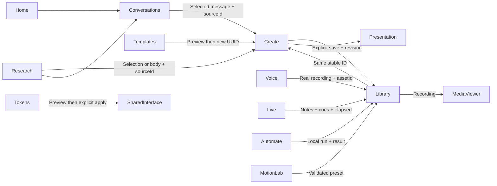

# Workflow map

| Journey | Implemented behavior | Acceptance evidence / limit |
|---|---|---|
| Home → Chat → Create → Save → Library | User text becomes own note, then a new document retaining sourceId | Automated end-to-end test; no AI artifact generation claimed |
| Templates → Preview → Document → Edit → Export | New document ID, editable text, undo/redo and SVG download | Automated journey |
| Research → Note → Create | Uses selected text if present, otherwise body | Automated body transfer; selection code path implemented |
| Library → Open → Edit → Save | Stable item ID and optimistic revision | Automated persistence/reload + API conflict test |
| Voice → Record → Playback → Save | Browser microphone, actual MediaRecorder bytes, server asset | Chromium synthetic microphone test; physical hardware not tested |
| Live → Cues → Present → Save | Real timer, pause, keyboard cue navigation | Automated journey; no AI transcript |
| Automate → Validate → Local run → Result | Fixed input/transform/output, deterministic text operations | Automated validation and saved-run test |
| Motion → Preset → Preview | Data-only presets; preview apply/import/export | Automated preset save + geometry interaction; scene application not available |
| Tokens → Preview → Apply | Accent affects real interface CSS variable; preview stays local until Apply | Implemented; extended scale editor not available |
| Media viewer → Project presentation → Return | Recording modal and document presentation each work | A unified cross-media gallery/presentation return workflow remains in progress |

New outputs use a new UUID intentionally; editing an existing saved item retains its ID. No hidden sample user history is inserted. Browser drafts and SQLite saves are distinct. Full scroll/filter/selection restoration across every workspace is not yet implemented.
