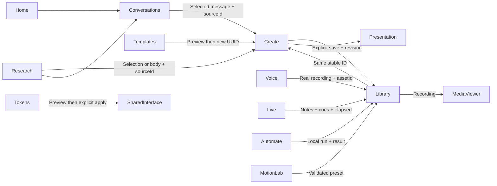
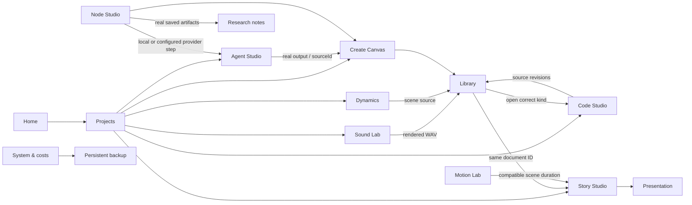

# Workflow map

| Journey | Implemented behavior | Acceptance evidence / limit |
|---|---|---|
| Home → Chat → Create → Save → Library | User text becomes own note, then a new document retaining sourceId | Automated end-to-end test; no AI artifact generation claimed |
| Templates → Preview → Document → Edit → Export | New document ID, editable text, undo/redo and SVG download | Automated journey |
| Research → Note → Create | Uses selected text if present, otherwise body | Automated body transfer; selection code path implemented |
| Library → Open → Edit → Save | Stable item ID and optimistic revision | Automated persistence/reload + API conflict test |
| Voice → Record → Playback → Save | Browser microphone, actual MediaRecorder bytes, server asset | Chromium synthetic microphone test; physical hardware not tested |
| Live → Cues → Present → Save | Real timer, pause, keyboard cue navigation | Automated journey; no AI transcript |
| Automate → Validate → Local run → Result | Fixed input/transform/output, deterministic text operations | Automated validation and saved-run test |
| Motion → Preset → Preview | Data-only presets; preview apply/import/export | Automated preset save + geometry interaction; scene application not available |
| Tokens → Preview → Apply | Accent affects real interface CSS variable; preview stays local until Apply | Implemented; extended scale editor not available |
| Media viewer → Project presentation → Return | Recording modal and document presentation each work | A unified cross-media gallery/presentation return workflow remains in progress |

New outputs use a new UUID intentionally; editing an existing saved item retains its ID. No hidden sample user history is inserted. Browser drafts and SQLite saves are distinct. Full scroll/filter/selection restoration across every workspace is not yet implemented.

## V2 connected journeys

All new work attaches to the selected project. All worlds includes legacy/unassigned work. Library searches/filter/sort operate on the active project context. Stories reference saved documents rather than duplicate them. Saved advanced tools reopen with the same stable ID and revision-keyed browser drafts. Undo/redo is separate session history. Browser source import is validate → preview → apply → explicit save; code runs only on Run. Node runs record actual step completion and retained artifact IDs. Interrupted runs do not invent completed steps. Graph-less V1 workflows retain the legacy compatibility editor.

# V3 connected workflows

- Home idea composer → persisted own-content conversation → Canvas → Library.
- Home/Projects → new linked Canvas/Code/Sound/Scene/Story → save revision → same item reopened from Library.
- Home portal reorder → browser preference → reload keeps order (does not modify documents).
- Copilot manual transcript → current question → selected Research notes → local evidence outline → editable answer → save session → Library → Copilot.
- Copilot → save Question Bank note → Practice with same question → self-review → saved practice session.
- Copilot → explicit context/tone/format prompt → Agent Studio (local/optional configured provider; provenance unchanged).
- Marketplace labeled original starter → preview/license → separate editable document or Research brief.
- Node Studio → local/optional agent nodes → actual note/document + run evidence.
- Design System themes → whole interface; source JSON tokens export. Scene presets retain explicit compatibility rules.
- Projects trash → linked work retained → undo/Library restore. Project duplication copies the project record only and says so.
- Command palette searches real workspaces and accessible scoped items; saved-item resolver routes specialized sessions/notes correctly.

Primary app remains hash-routed for existing hosting compatibility. Aliases include assets→library, pipeline→automate, canvas→create, live-code/inspector→code and components→design-system. Existing URLs remain available. No new external public service is claimed.

## Modern Builder workflows

- Home concept → Builder → preset preview → apply to draft → edit / validate / Undo → HTML/CSS/config export.
- Builder → explicit save as new code item → existing Code Studio → deliberate Run → native storefront in opaque-origin iframe → Library/revisions.
- Builder brief → existing local brief tool → actual saved agent-run with local-tool provenance.
- Storefront preview → category → product detail → sample bag → remove/clear; no order or checkout.
- Rig specimen → consent → actual microphone FFT → stop/navigation cleanup; no audio recording, upload or transcription.

## Unified reconstruction entry points
Home Extract → Research existing notes/sources. Home Compose → #/builder (within shared Shell) → existing local template draft → validated HTML/CSS export or save CodeDocument → Code Studio → Library. Home Ship → Library actual saved artifacts/export. Sidebar and command palette discover Builder. Design System → native brand lockups and shared tokens → Builder. Historical #/concept links remain compatible, but are no longer primary navigation. All original entity IDs, drafts, revisions and data stores retained.

Reference pack adoption: Home / Templates → #/patterns → original layout detail → draft/edit → explicit sandbox preview → validated preset/HTML export or new CodeDocument → Code Studio → Library. #/patterns contains8 original working recipes and a separate searchable60-entry source inventory. Import follows validate/review/apply and never executes imported code. Current source map and boundaries: docs/reference-library/ADOPTION.md.

Canonical-domain journey: legacy origin → complete transfer file (saved work/media/history/browser drafts) → primary #/transfer → validate/checksum/review → destination rollback download → stage browser writes → merge records → verify actual backup and draft writes → reload chosen route. ID conflicts become linked copies; destination originals remain. Origin receipt maps old item routes to canonical copies after explicit legacy forwarding. ?recovery=1 always retains legacy access; source stores are never cleared.

## Editorial studio navigation — 2026-11-09

Home has three real process links: Extract → Research; Compose → Builder; Ship → Library. The primary shell exposes Home/Projects/Chat/Library plus Builder/Create/Templates/Patterns. All tools opens a grouped19-route directory; specialized tools retain their existing deep links and active-project data. Mobile replaces its drawer with the directory, and Escape returns to the menu trigger. Home draft → saved conversation, Templates → new document → Editor → Library, and Builder → Code Studio continue using the same entities and persistence engines. See docs/editorial-redesign/SYSTEM.md.
